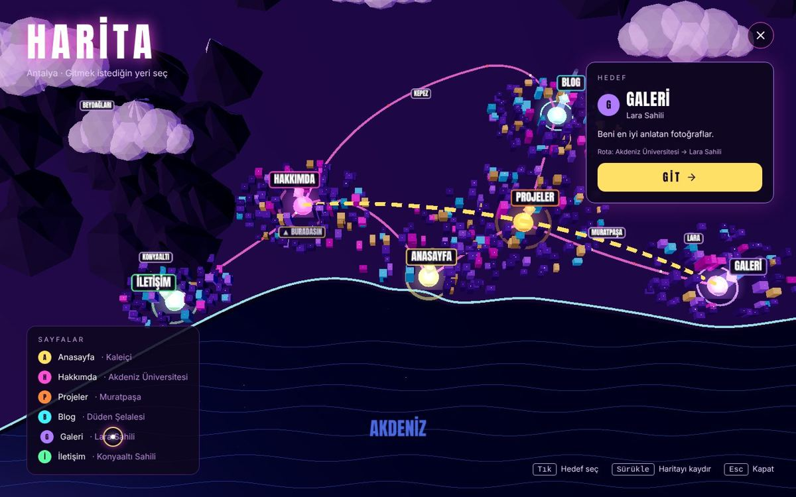
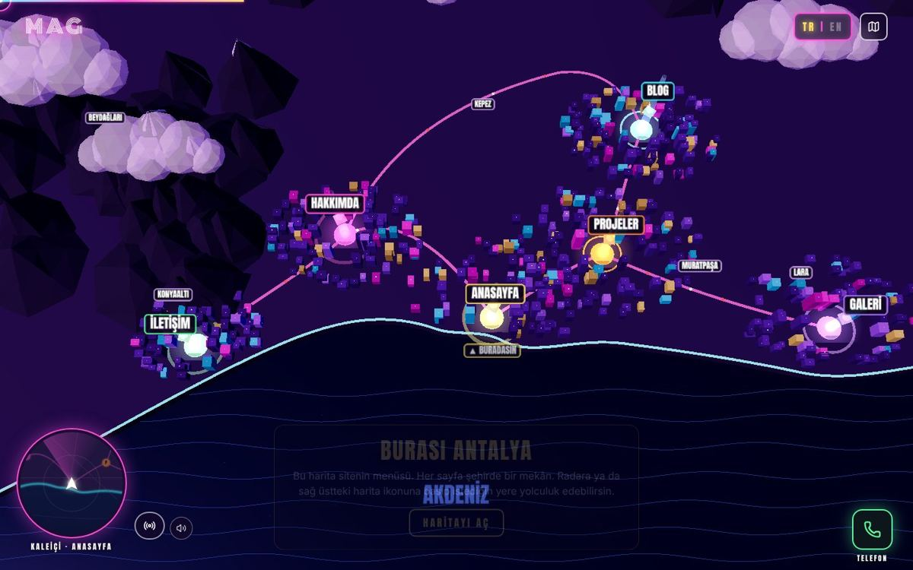
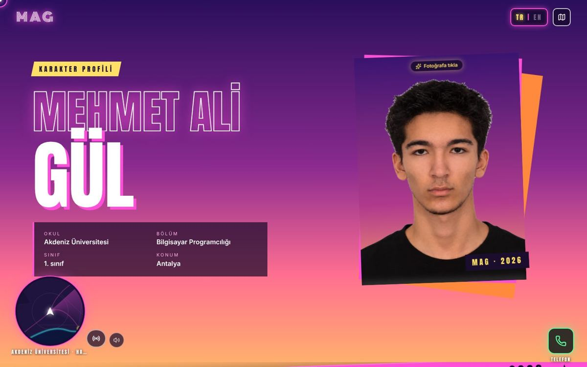
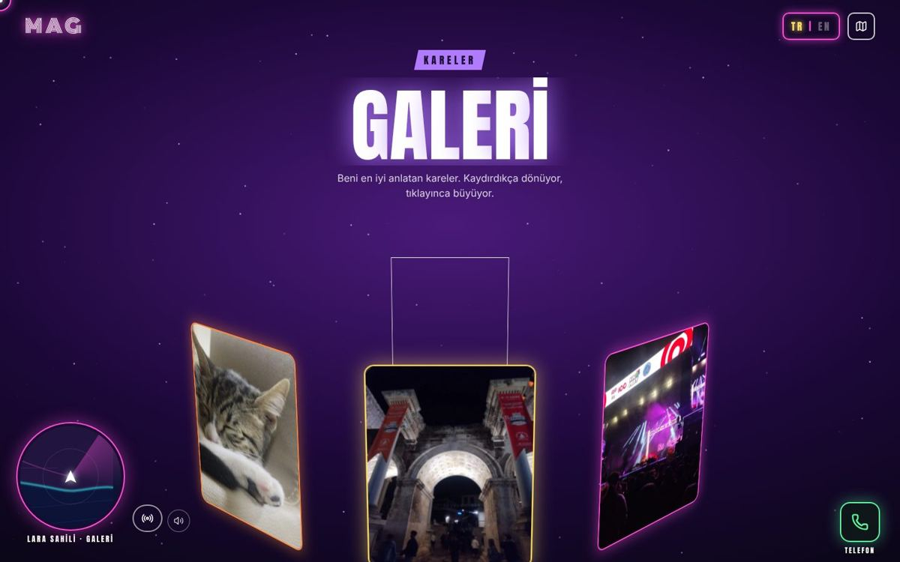
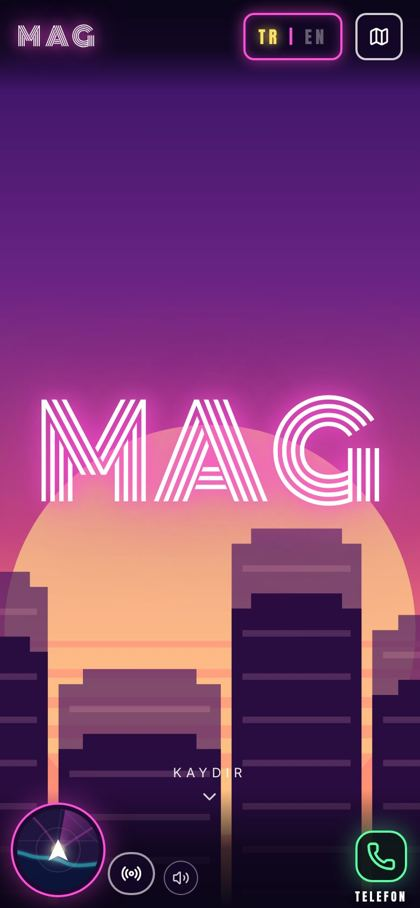

# MAG · Mehmet Ali Gül — Kişisel Web Sitesi

GTA temalı, **3D Antalya haritası** ile gezilen, iki dilli (TR / EN) kişisel tanıtım sitesi.

**🌐 Canlı site:** [maliglweb.netlify.app](https://maliglweb.netlify.app) · **🎬 Tanıtım videosu:** [youtu.be/FJjnA3jJtbw](https://youtu.be/FJjnA3jJtbw)



## Fikir

Site bir açık dünya oyunu gibi çalışır: menü, Antalya'nın üç boyutlu haritasıdır ve her sayfa şehirde bir mekândır. Haritada bir yer seçip **GİT**'e basınca kamera oraya uçar ve sayfa açılır.

| Sayfa | Mekân | İçerik |
|---|---|---|
| [Anasayfa](https://maliglweb.netlify.app/) | Kaleiçi | Karşılama, hakkımda özeti, proje ve galeri önizlemeleri |
| [Hakkımda](https://maliglweb.netlify.app/hakkimda.html) | Akdeniz Üniversitesi | Özgeçmiş, yetenekler (%), ilgi alanları, ders programı |
| [Projeler](https://maliglweb.netlify.app/projeler.html) | Muratpaşa | Grafik Animasyon I dersinin 6 Photoshop çalışması (önce / sonra) |
| [Blog](https://maliglweb.netlify.app/blog.html) | Düden Şelalesi | Bilişim üzerine 3 yazı, ekran görüntüleriyle |
| [Galeri](https://maliglweb.netlify.app/galeri.html) | Lara Sahili | Kaydırdıkça dönen 3D fotoğraf halkası |
| [İletişim](https://maliglweb.netlify.app/iletisim.html) | Konyaaltı Sahili | Adres, telefon, e-posta, iletişim formu |

## Öne çıkanlar

- **3D harita (Three.js):** bulutlar, akan trafik, deniz parıltıları, imleçle açılan dalga halkaları, rota çizimi ve kamera uçuşu
- **Kaydırmalı sahneler (GSAP ScrollTrigger + Lenis):** anasayfada aşağı kaydırdıkça bulutlar açılır, harita düzleşir, kamera Anasayfa noktasına dalar
- **Sanal telefon:** ders programı (Takvim) ve iletişim formu (Mesajlar) gerçek saat ve tarihle çalışan bir telefonda açılır
- **İki dil:** sağ üstteki neon TR | EN tabelasıyla tüm site İngilizceye çevrilir
- **Duyarlı tasarım:** telefon ve tablet için ayrı "hafif mod"; ağır efektler sadeleşir, 3D harita kalitesini kendiliğinden ayarlar, WebGL yoksa 2D haritaya geçer
- **SEO / GEO:** sayfa başına title ve description, Open Graph, canonical, hreflang, JSON-LD, `sitemap.xml`, `llms.txt`
- **Kodla üretilen ses:** arayüz sesleri ve MAG FM radyosu Web Audio ile üretilir, ses dosyası yok

| Kaydırmalı harita | Hakkımda | Galeri | Telefon |
|---|---|---|---|
|  |  |  |  |

## Teknolojiler

Vite · React · TypeScript · Tailwind CSS · Three.js · GSAP (ScrollTrigger) · Lenis · Motion · shadcn/ui · Magic UI · Aceternity UI

## Çalıştırma

```bash
npm install
npm run dev            # geliştirme sunucusu
npm run build          # dist/ → sunucuya yüklenecek sürüm
npm run build:teslim   # teslim-site/ → dosyaya çift tıklayınca açılan sürüm
```

## Proje yapısı

```
src/
├── pages/          # her sayfanın içeriği (home, about, projects, blog, gallery, contact)
├── components/
│   ├── map/        # 3D harita (Map3D.ts), harita menüsü, 2D yedek harita
│   ├── phone/      # sanal telefon: takvim ve mesajlar
│   ├── shell/      # üst çubuk, radar, radyo, yükleme ve varış efektleri
│   └── scene/      # gün batımı sahnesi, neon ızgara
└── lib/            # sayfa bilgileri, dil, galeri, ses, kaydırma
```

---

Akdeniz Üniversitesi · Bilgisayar Programcılığı · *Web Tasarımının Temelleri* vize projesi, 2026.
Yapay zekâ (Claude) ile birlikte geliştirildi.
